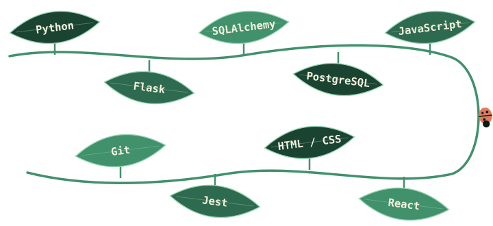
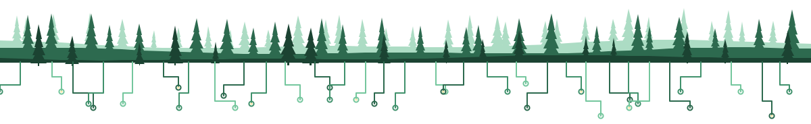

I got into code because I love helping people, and software lets me reach more of them.
I'm in Cohort 26 at Ada Developers Academy, building full-stack projects from the database up to the browser.

### `what grows here`

### `things I've planted`

| project | what it does | built with |
| :-- | :-- | :-- |
| [**Task List API**](https://github.com/najmashanle/task-list-api) | REST API for creating, updating and completing tasks and goals. Deployed on Render. | Flask, PostgreSQL |
| **Solar System API** | Team-built API for planets and their moons. | Flask, SQLAlchemy |
| **Weather Report** | Looks up a city with LocationIQ and pulls live conditions from OpenWeather. | JavaScript |
| **Adagrams** | Word game built in Python, then ported to JavaScript with Jest tests. | Python, JavaScript |

### `currently`

Building with React and getting ready for my capstone project.

### `find me`

[LinkedIn](https://www.linkedin.com/in/najma-shanle-884b44135/)

